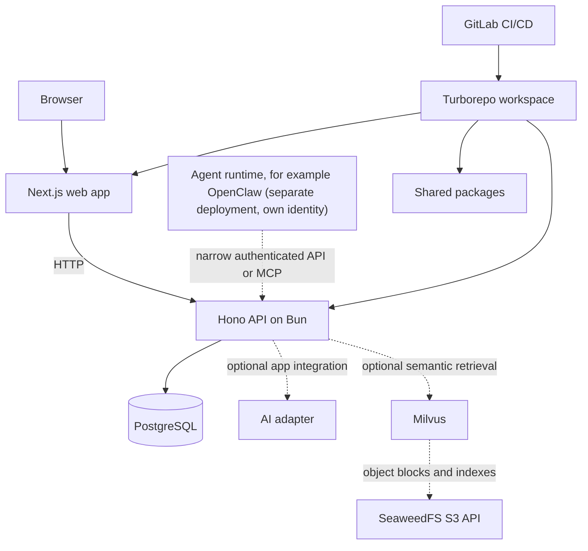

# PHANTOMS architecture

PHANTOMS is a set of explicit application boundaries. The letters name the core choices; they do not require every service to run in every app.

## Core letters

| Letter | Default boundary | Guidance |
| --- | --- | --- |
| **P — PostgreSQL** | `packages/db` owns connection setup, schema, and migrations. | Use relational tables for durable application records. Keep migrations reviewable and test upgrades against disposable data. |
| **H — Hono** | `apps/api` owns HTTP routes and request validation. | Run with Bun. Keep business and persistence code out of route handlers as the app grows. |
| **A — AI** | `packages/ai` owns model access behind an adapter. | Keep credentials on the server, use time and token budgets, validate structured outputs, and isolate provider-specific details. |
| **N — Next.js** | `apps/web` owns the browser experience. | The starter builds a static App Router site so the deployed app needs no additional JavaScript server runtime. Add server rendering only after its Bun runtime path is independently proven for the chosen hosting setup. |
| **T — Turborepo** | Root scripts define the task graph. | Workspaces and `bun.lock` make installs repeatable. CI runs the same commands as local development. |
| **O — OpenClaw** | One example of an optional agent runtime, deployed separately from the app. | OpenClaw is a personal or team assistant gateway, not a library the API embeds. It reaches the app only through a narrow authenticated API or an MCP server. See [Agent runtime options](#agent-runtime-options). |
| **M — Milvus** | An optional retrieval service. | Add when vector or hybrid search has a measured need. Benchmark indexing, query quality, memory, and backup/restore before production. |
| **S — SeaweedFS** | Optional S3-compatible object storage. | Add for binary data or Milvus object storage after verifying the exact client/backend semantics and recovery process. |

## Core versus optional services

The runnable starter includes PostgreSQL, a Hono API, a static Next.js site, and an AI adapter package. This makes the first local run light enough for learning while showing the seams where the other PHANTOMS pieces fit.

| Layer | Add when | Example additions |
| --- | --- | --- |
| Identity | A route serves more than the local developer. | OIDC provider such as Keycloak; API authorization and tenant checks remain application responsibilities. |
| Cache / queue | Measured latency, background work, or coordination requires it. | Redis or another managed queue/cache. Define expiry, retry, and idempotency behavior. |
| User search | Relational filtering is no longer the right search experience. | Meilisearch; define index synchronization and deletion behavior. |
| Retrieval | Semantic/hybrid search improves a tested workflow. | Milvus, embeddings, and an object store such as SeaweedFS. Track source IDs, authorization, freshness, and deletion through every index. |
| Agents | A product has bounded work that benefits from tools or multi-step orchestration. | An agent runtime such as OpenClaw, deployed separately, calling the app through a narrow authenticated API or MCP server with per-agent tools, resource limits, audit records, and a human approval step for consequential actions. |
| Observability | The app has an operational target and can act on telemetry. | Metrics, structured logs, traces, alerts, and dashboards. Avoid sending secrets or personal content in telemetry. The starter already emits JSON logs with request IDs and has opt-in OTLP traces; see [recommended tooling](recommended-tooling.md#observability). |

Do not adopt every optional service just because it appears in the acronym. Every stateful service adds security, cost, capacity, backup, upgrade, and recovery work.

## Agent runtime options

The **O** is one example of a pattern, not a required component. An agent runtime is a program that holds a model conversation, decides which tools to call, and acts. PHANTOMS does not embed one. It keeps the runtime in a separate deployment with its own identity and gives it a small, authenticated surface to call.

**OpenClaw as the example.** OpenClaw describes itself as an open-source AI assistant that runs on your own computer and meets you in chat channels such as Discord, Slack, Teams, Telegram and WhatsApp. One Gateway process serves it, either as a personal assistant or as a shared one for a team. It is an operator-facing assistant gateway, so the natural fit is an assistant that staff talk to in chat and that calls your app's API on their behalf. It is not an agent library that the Hono API imports or calls in-process.

**The neutral pattern.** Whatever the runtime is (OpenClaw, another assistant gateway, a coding agent, a framework you run yourself), connect it the same way:

| Option | What the app exposes | Choose it when |
| --- | --- | --- |
| Narrow authenticated API | A few `/api/` routes with their own credential, rate limits and per-record authorization. | The runtime can call plain HTTP and you want ordinary API controls and logs. |
| MCP server | A [Model Context Protocol](https://modelcontextprotocol.io/) endpoint with a short list of read-only tools, behind a bearer token. | The runtime or harness already speaks MCP and you want to attach it without custom glue. |
| Both | The API for the app's own clients and the MCP server for agent harnesses, sharing the same data access layer. | Several kinds of clients need the same capability. |

In every option the runtime gets its own credential, separate from any user's and from the database's; the app authorizes each call itself, and the tool list is the allowlist. See [Security](security.md) for the boundary and [The AI layer](ai.md) for how model access and tools fit.

**Runnable MCP example.** `apps/mcp` is a small optional workspace that exposes two read-only tools, `list_tasks` and `get_task`, over MCP's streamable HTTP transport using the official `@modelcontextprotocol/sdk`. Every request needs `Authorization: Bearer <MCP_BEARER_TOKEN>`, compared in constant time. It is a separate workspace rather than a route group in `apps/api` so that it stays out of the API image, the default Compose file and the default `bun run dev`; start it on purpose with `bun run --filter @phantoms/mcp start`. Its integration test runs in the normal `bun test`. Any MCP-capable harness, OpenClaw included, can be pointed at its `/mcp` URL with the token in an authorization header.

**Where OpenClaw runs.** OpenClaw is a Node application. Install and operate it on its own, not inside the app's Bun workspace, dependency tree or container image.

### Facts checked on 2026-11-04

These were read from the project's public pages on 2026-11-04 and will drift. Re-check them before relying on them.

| Fact | Value | Source |
| --- | --- | --- |
| Role | Open-source personal or shared assistant that runs on your devices and connects to chat channels through one Gateway | [README](https://github.com/openclaw/openclaw#readme) |
| Node requirement | Node 24.22.1 or newer, or 26.12.1 or newer (Node 26 recommended) for the published package | [README, Install](https://github.com/openclaw/openclaw#install) |
| Latest release | `v2026.10.10`, published 2026-11-03 | [Releases](https://github.com/openclaw/openclaw/releases) |
| License | MIT | [Repository](https://github.com/openclaw/openclaw) |
| Security advisories | 722 published as listed on the advisories page; the most recent was published on 2026-09-11 | [Security advisories](https://github.com/openclaw/openclaw/security/advisories) |
| MCP | Can save outbound MCP server definitions, including a streamable HTTP transport with request headers, and can itself run as an MCP server | [OpenClaw MCP docs](https://docs.openclaw.ai/cli/mcp), [transports](https://docs.openclaw.ai/cli/mcp/transports) |

With frequent releases and a long public advisory list, an OpenClaw version pin is a decision to review, not a default to inherit. Read the advisories page before each pin bump; [Version policy](version-policy.md) holds the reference pin.

## Request and data flow

1. A browser loads the Next.js static output from a web host or reverse proxy.
2. The browser calls Hono through a same-origin proxy or an explicitly configured API origin.
3. Hono authenticates and authorizes the caller before application operations. The local sample binds to loopback and is intentionally not an internet-ready API.
4. Hono validates inputs, uses PostgreSQL for durable records, and calls the AI adapter only on server-side code paths.
5. Optional retrieval and object storage stay behind internal service boundaries and receive only the minimum data needed for a task. An optional agent runtime is a separate caller of the app: it authenticates to the app's API or MCP server like any other client and never reaches the database directly.

The sample currently demonstrates API validation, database storage, health/readiness separation, and the AI provider boundary package. It does not wire a model call into an unauthenticated route. It also does not implement production identity, tenant authorization, a deployed agent, embeddings, object-storage policies, or a production backup service.

## Deployment shape

- Serve the static Next export from a controlled web host or reverse proxy, or use the provided `Dockerfile` to serve it from Hono in the same Bun container.
- Run the Hono service in a Bun image behind a TLS-terminating ingress.
- Keep PostgreSQL and optional stateful services on private networks with authentication, encryption, backup, restore tests, and capacity alerts.
- Route browser API calls through the same origin when possible; otherwise use a narrow explicit CORS allowlist.
- Keep model and service credentials in the deployment's secret manager. Never put them in the image, repository, query string, or browser bundle.
- Deploy immutable image digests only after build, scan, test, SBOM, and provenance gates pass.

See [CI/CD](ci-cd.md) and [Security](security.md) for the operating contract.

For the complete supporting tool set from the original PHANTOMS proposal, see [Recommended supporting tools](recommended-tooling.md).
